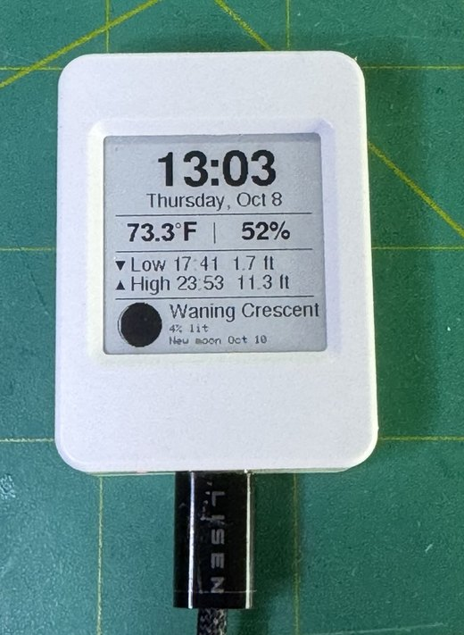
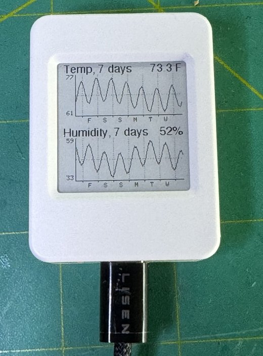
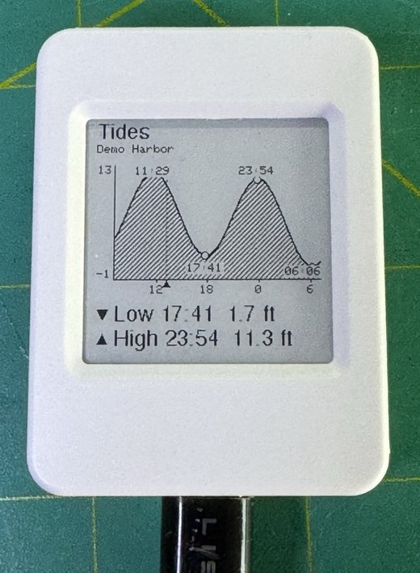

# ESP32-S3-ePaper-1.54 TTHTLPL

**T**ime, **T**emperature, **H**umidity, **T**ides, and **L**unar **P**hase **L**ogger: a desk
clock for the **Waveshare ESP32-S3-ePaper-1.54** (200×200 black-and-white e-paper). It shows the
time, the room's temperature and humidity, the next tides for a NOAA station you choose, and the
moon phase, and it quietly logs the climate to build a 7-day graph. Because e-paper keeps its image
with no power, the screen costs nothing between updates.

<p align="center">
  
  
  
</p>
<p align="center"><sub>The three pages (the tide page is showing synthetic demo data).</sub></p>

## What it does

| Page | Shows |
|---|---|
| **1 Clock** | Time and date, temperature and humidity, the next two tides, moon phase with percent lit and the date of the next new or full moon |
| **2 Climate** | The last 7 days of temperature and humidity, with day markers |
| **3 Tides** | A 24-hour tide curve (6 hours back, 18 ahead) with a "now" marker, high and low times, and the next two events |

**Buttons:** **BOOT** = next page, **PWR** = previous page, **hold BOOT for 2 seconds** = open the
phone setup page. The display returns to the clock page by itself after 3 minutes.

**Logging:** every 10 minutes (on the :00, :10, :20 … marks) it appends a reading to a small file
in the board's flash (8 bytes per sample, about 8 KB a week) which feeds the graph, and, if a microSD
card is fitted, adds a row to `/climate/log.csv` as permanent, human-readable history. The card is
never formatted and nothing else on it is touched.

**Tides** come from [NOAA CO-OPS](https://tidesandcurrents.noaa.gov) (free, no key). About 9 days of
predictions are cached in flash, so tides keep working for over a week without Wi-Fi. They refresh
whenever the clock is online and fewer than 3 days remain, or when you change the station.

## Setup

On first start, the clock shows a QR code. Scan it (or join the open Wi-Fi network
`EPaper-Clock-Setup`) and a setup page opens on your phone with:

* your Wi-Fi network and password (2.4 GHz)
* time zone (daylight saving is handled by the zone's rules)
* 12- or 24-hour clock
* Fahrenheit/feet or Celsius/metres
* your **NOAA tide station ID**: find the nearest station on the
  [NOAA tide predictions map](https://tidesandcurrents.noaa.gov/tide_predictions.html); the 7-digit
  number is its ID. The default (9447130) is only a placeholder.

Hold **BOOT** for 2 seconds any time to reopen it. Leave the network blank to change only the
other settings. The setup network is open and your Wi-Fi password crosses it once over plain HTTP
(see Limitations); settings are stored on the board and never in the source code.

## How it works

* **Time.** The board's PCF85063 RTC keeps time across power cuts. A factory-fresh RTC reports an
  arbitrary date, so the firmware only trusts it after it has written a real time into it (via NTP
  or the `T` serial command) and set a flag. NTP re-syncs at boot and every 6 hours, then Wi-Fi
  turns off.
* **Moon.** Computed on the chip from the Sun–Moon elongation series in Meeus' *Astronomical
  Algorithms* (good to a few hours for new/full moon, about 0.1 % for the lit fraction). The disc is
  drawn from the geometry of the terminator, one scanline at a time. It is drawn as seen from the
  northern hemisphere (a waxing moon is lit on the right); a southern-hemisphere view would be
  mirrored.
* **Tides.** NOAA publishes high and low predictions; the curve between them uses cosine
  interpolation, the standard approximation for a tide-clock face.
* **Temperature accuracy.** The humidity/temperature sensor sits a few millimetres from the
  processor and reads warm. Two things reduce that: the CPU runs at 80 MHz (plenty for a clock) and
  a calibration offset is applied (`O` command, see below). Humidity is then re-derived for the
  corrected temperature with the Magnus formula, because the same amount of water vapour is a higher
  percentage in cooler air; without it humidity would read far too low.
* **Display.** Every page is drawn by one routine that targets either the panel or an in-memory
  canvas. The canvas is what makes serial screenshots possible, since e-paper can't be read back.
  The clock refreshes with a fast partial update each minute and a full flash every 10 minutes to
  clear ghosting.

## Hardware

Waveshare ESP32-S3-ePaper-1.54 (ESP32-S3-PICO-1: 8 MB flash, 8 MB PSRAM) with a 200×200 SSD1681-family
e-paper, PCF85063 RTC, SHTC3 sensor, ES8311 audio codec, microSD slot. Pins and quirks, from
Waveshare's own demo repository:

| Function | Pins |
|---|---|
| E-paper (SPI) | DC 10, CS 11, SCK 12, MOSI 13, RST 9, BUSY 8 |
| E-paper power | GPIO 6, **active low** |
| RTC / sensor / codec power | GPIO 42, **active low** (the I2C devices don't answer with it off) |
| Battery power latch | GPIO 17 (hold high when running from a battery) |
| I2C | SDA 47, SCL 48 (RTC 0x51, SHTC3 0x70, codec 0x18) |
| microSD (1-bit SD_MMC) | CLK 39, CMD 41, D0 40 |
| Buttons | BOOT 0, PWR 18 |

`hardware_check/hardware_check.ino` is a small sketch that powers the rails, scans I2C, reads the
sensor and RTC, and draws a test pattern. It's a quick way to confirm a board before flashing the
clock.

## Build and flash

You need [arduino-cli](https://arduino.github.io/arduino-cli/) (the Arduino IDE's bundled copy
works) and the ESP32 Arduino core 3.3.x:

```sh
arduino-cli lib install GxEPD2 ArduinoJson
EPaperClock/tools/build.sh /dev/cu.usbmodemXXXX      # leave the port off to only compile
```

Two build settings matter and are in the script: **`CDCOnBoot=cdc`** (without it `Serial` prints
nothing over this board's USB port) and the **`huge_app`** partition (the default one is too
small, and this one still leaves flash for the log).

## Serial commands (115200 baud)

Opening the port resets this board, so wait about 8 seconds before sending anything.

| Command | Effect |
|---|---|
| `?` | Status: time source, zone, units, Wi-Fi, tide station, log size, SD, current reading |
| `T<epoch>` | Set the time (and the RTC) by hand |
| `O<degrees C>` | Temperature offset, e.g. `O-2.8`. Compare with a trusted thermometer after the board has run for a while, and recalibrate if you put it in a case |
| `E<station id>` | Set the tide station |
| `R` | Refetch tides now |
| `N` / `B` | Next / previous page |
| `S[page]` | Screenshot (see below) |
| `D` | Dump the flash log as CSV |
| `C` | Show the tail of the SD card CSV |
| `W<ssid><TAB><password>` | Save Wi-Fi without the phone page |
| `X` / `P` | Forget Wi-Fi / open the setup page |
| `F` / `Z` | Load demo data into the log and tide cache / clear them |
| `V` | Toggle the demo view (synthetic data, nothing stored) |

**Screenshots:** `EPaperClock/tools/screenshot.py PORT out.png [page] [--demo]` captures any page as
a PNG (needs `pip install pyserial pillow`). `--demo` shows the synthetic view, which is how the
README photos were staged.

## Limitations

* The setup Wi-Fi network is **open**, and your home Wi-Fi password crosses it once, in plain
  HTTP. It's only up during setup (at most 10 minutes) and within Wi-Fi range, but anyone nearby at
  that moment could in principle see it. Use the `W` serial command if that matters to you.
* Connections to NOAA don't verify the server's TLS certificate (`setInsecure()`). The data is
  public and nothing secret is sent, but it means a man-in-the-middle could feed false tides.
* The sensor reads warm because of the board's own heat. The offset is calibrated against one
  reference point and will shift with enclosure, airflow and ambient temperature.
* The offset also assumes a steady load; Wi-Fi activity warms the sensor for a few minutes.
* Tide predictions are astronomical predictions; storms and river flow can move the real water level.
* Not a navigation or safety tool.

## Credits and licences

The code in this repository is MIT licensed (see `LICENSE`).

* Tide predictions: NOAA CO-OPS (US government data).
* Moon formulas: Jean Meeus, *Astronomical Algorithms*.
* Pin definitions: [Waveshare's ESP32-S3-ePaper-1.54 demo repository](https://github.com/waveshareteam/ESP32-S3-ePaper-1.54).
* Libraries (not included): [GxEPD2](https://github.com/ZinggJM/GxEPD2) (**GPL-3.0**),
  [Adafruit GFX](https://github.com/adafruit/Adafruit-GFX-Library) (BSD),
  [ArduinoJson](https://arduinojson.org) (MIT), and the ESP32 Arduino core.

**Note on GxEPD2:** this source code doesn't contain any GxEPD2 code, so it stands under the MIT
licence. A compiled firmware image, however, links GxEPD2, so if you distribute binaries you must do
so under the GPL-3.0's terms.
